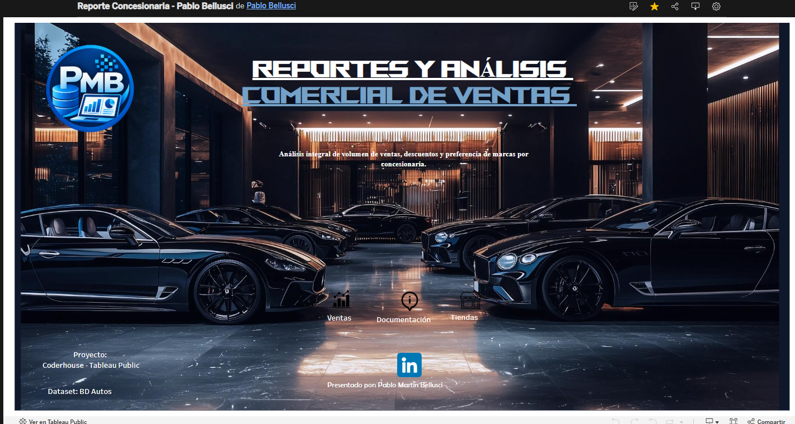
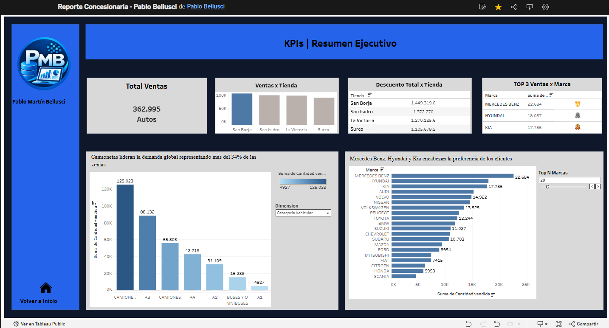
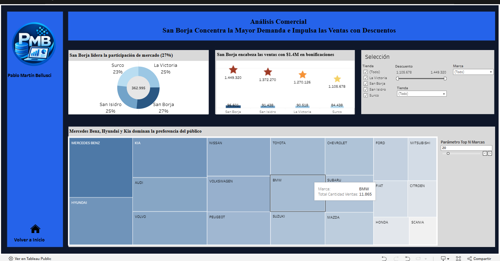
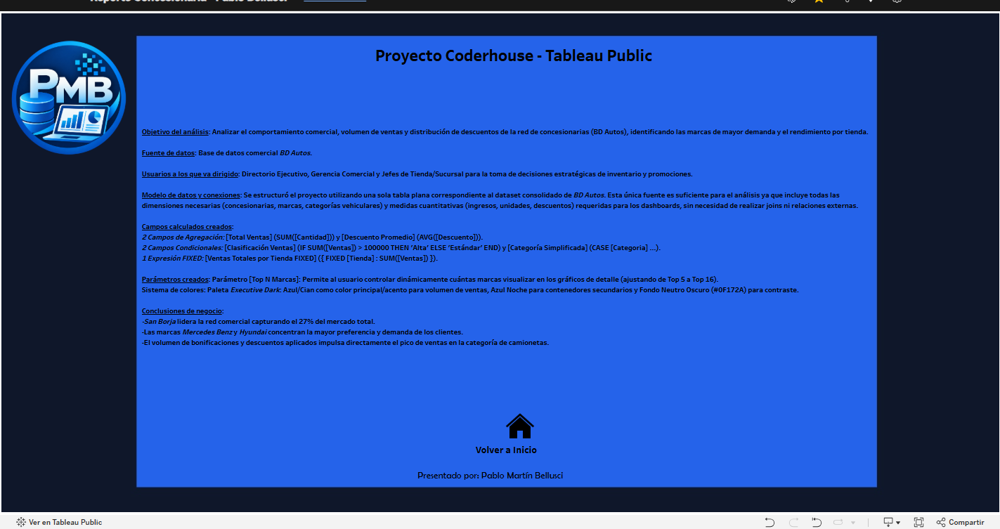

# Tableau-Dashboard-BD-Autos
Dashboard ejecutivo e interactivo en Tableau Public sobre análisis comercial y ventas de concesionarias (BD Autos).

# 🚘 Análisis Comercial & Ventas de Concesionarias — BD Autos

Dashboard ejecutivo e interactivo desarrollado en **Tableau Public** como proyecto integrador final para Coderhouse. El objetivo es analizar el volumen de ventas, la efectividad de las bonificaciones/descuentos y la preferencia de marcas por sucursal.

### 🔗 [👉 VER DASHBOARD INTERACTIVO EN VIVO (TABLEAU PUBLIC)](https://public.tableau.com/app/profile/pablo.bellusci/viz/BDAutos-Dashboard/Presentacin)

---

## 📊 Estructura del Proyecto y Vistas

### 1. Portada & Navegación Ejecutiva
Pantalla principal de bienvenida con acceso directo a las vistas analíticas y a la ficha técnica del proyecto.

### 2. Resumen Macro & KPIs Globales
Panorama general de las **362.995 unidades vendidas**, desglose por concesionaria, ranking dinámico (Parámetro Top N) y distribución por categoría vehicular.

### 3. Análisis Comercial por Tienda (Gráficos Avanzados)
Exploración interactiva mediante **Gráfico de Dona** (participación de mercado donde San Borja lidera con el 27%), **Eje Doble sincronizado** (volumen físico vs. $1.4M en descuentos) y **Treemap** filtrado dinámicamente por sucursal.

### 4. Documentación Técnica
Ficha metodológica con el modelo de datos, campos calculados (`FIXED`, `CASE`, agregaciones), parámetros y sistema de colores *Executive Dark*.

---

## 🛠️ Herramientas y Técnicas Aplicadas
* **Visualización:** Tableau Public / Tableau Desktop.
* **Lógica de Negocio:** Expresiones LOD (`FIXED`), condicionales (`IF` / `CASE`) y métricas agregadas[cite: 1].
* **Interactividad:** Acciones de filtro con reseteo automático, parámetros dinámicos (`Top N Marcas`) y navegación integrada por botones[cite: 1].

---
**Autor:** Pablo Martín Bellusci[cite: 3]
